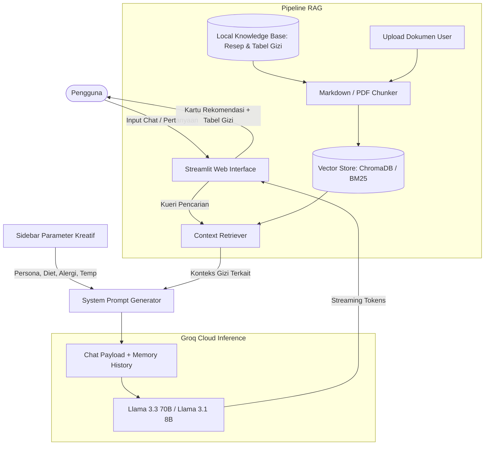

# 🥗 NutriChef AI — Smart Nutrition & Meal Planner Assistant

> **Final Project: Chatbot Berbasis AI dengan LLM & Retrieval-Augmented Generation (RAG)**  
> Dibangun menggunakan **Python**, **Streamlit**, **Groq Cloud API (Llama 3.3 70B & Llama 3.1 8B)**, dan **Hybrid RAG Knowledge Base**.

[](https://www.python.org/)
[](https://streamlit.io/)
[](https://groq.com/)
[](#arsitektur-sistem)
[](LICENSE)

---

## 📖 1. Ringkasan Proyek & Use Case

**NutriChef AI** adalah asisten kecerdasan buatan cerdas yang dirancang untuk memecahkan dilema harian masyarakat: *"Hari ini masak apa yang sehat, hemat, dan sesuai target tubuh saya?"*. 

Aplikasi ini bertindak sebagai perencana menu makanan (*meal planner*) dan konsultan nutrisi interaktif. Pengguna dapat berkonsultasi mengenai resep masakan berbasis bahan yang mereka miliki di rumah, menghitung estimasi kebutuhan kalori (TDEE & BMR), serta mendapatkan rancangan menu yang dipersonalisasi sesuai profil kesehatan, pantangan alergi, dan preferensi diet khusus.

---

## 🎨 2. Parameter Kreatif & Fitur Unggulan

Proyek ini mengimplementasikan parameter konfigurasi kreatif yang dapat disesuaikan langsung oleh pengguna melalui sidebar interaktif:

### A. Persona & Gaya Bahasa AI (Tone & Manner)
- 👨‍🍳 **Chef Ramah & Inspiratif**: Gaya bahasa santun, bersahabat, penuh motivasi, dan kaya akan tips kuliner praktis agar masakan sehat tetap lezat.
- 🩺 **Ahli Gizi Medis (Clinical Dietitian)**: Gaya bahasa formal, ilmiah, berbasis bukti medis, fokus pada indeks glikemik, profil makronutrien, dan kestabilan metabolisme.
- 🏋️‍♂️ **Fitness & Bodybuilding Coach**: Gaya bahasa enerjik, to-the-point, fokus pada target protein harian, *clean bulking*, dan pemulihan performa fisik.

### B. Konfigurasi Pola Makan & Target Diet
- **Defisit Kalori (Fat Loss)**: Pengurangan 300-500 kkal di bawah TDEE dengan fokus protein tinggi & volume serat.
- **Clean Bulking (Muscle Gain)**: Surplus kalori berkualitas untuk pembentukan massa otot bebas lemak.
- **Rendah Karbohidrat / Ketogenik**: Pembatasan ketat karbohidrat (<50g/hari) untuk memicu ketosis.
- **Rendah Gula (Diabetes-Friendly)**: Penggunaan bahan dengan Indeks Glikemik (GI) rendah (<55).
- **Rendah Garam (DASH Diet / Hipertensi)**: Pembatasan natrium (<1.500 mg) dengan pemanfaatan rempah aromatik alami.

### C. Filter Alergi & Pantangan Otomatis
Pengguna dapat memasukkan bahan yang dihindari (misal: *kacang, udang, gluten, laktosa*). NutriChef AI akan memvalidasi resep dan memberikan substitusi bahan yang aman tanpa mengurangi kualitas nutrisi.

### D. Parameter Teknis Model AI (Groq Engine)
- **Model Switcher**: Pilihan model antara `llama-3.3-70b-versatile` (penalaran terbaik) dan `llama-3.1-8b-instant` (kecepatan respon instan).
- **Temperature Slider**: Mengatur tingkat kreativitas respons LLM dari 0.0 (deterministik/faktual) hingga 1.0 (kreatif).

### E. Hybrid RAG (Retrieval-Augmented Generation)
- **Pre-curated Local Knowledge Base**: Dilengkapi basis data resep sehat nusantara, tabel nilai gizi bahan pangan (TKPI Kemenkes & USDA), dan panduan klinis diet terstruktur.
- **Dynamic File Ingestion**: Fitur unggah file (PDF, TXT, MD) secara dinamis langsung dari antarmuka web, sehingga pengguna dapat memasukkan resep kustom atau dokumen catatan medis mereka sendiri.

### F. Multi-turn Memory & Fitur Ekspor
- **Percakapan Kontekstual**: Bot mengingat riwayat diskusi sebelumnya sehingga pengguna dapat meminta revisi menu (contoh: *"Ganti ayamnya dengan tahu dan hitung ulang kalorinya"*).
- **Ekspor Riwayat Chat**: Tombol unduh transkrip konsultasi dalam format Markdown (`.md`).
- **Reset Sesi**: Kemudahan mengosongkan riwayat dengan satu klik.

---

## 🏗️ 3. Arsitektur Sistem

Berikut adalah diagram alur kerja pemrosesan percakapan dan RAG pada NutriChef AI:



---

## 📁 4. Struktur Direktori Proyek

```text
nutrichef-ai/
├── app.py                      # Antarmuka web utama Streamlit & controller chat
├── rag_pipeline.py             # Engine RAG (ChromaDB Vector Store, PDF Ingestion, BM25)
├── prompts.py                  # Konfigurasi Persona, aturan diet, dan template respon
├── data/
│   └── knowledge_base/         # Basis pengetahuan terkurasi bawaan sistem
│       ├── resep_sehat_nusantara.md    # Resep masakan lokal bergizi seimbang
│       ├── tabel_nutrisi_bahan.md      # Tabel referensi kalori & makro pangan
│       └── panduan_diet_terstruktur.md # Aturan medis diet & substitusi alergi
├── .env.example                # Contoh konfigurasi environment variable
├── .gitignore                  # Berkas pengabaian Git (env, cache, venv)
├── requirements.txt            # Daftar pustaka & dependensi Python
└── README.md                   # Dokumentasi lengkap proyek
```

---

## 🚀 5. Panduan Instalasi & Menjalankan Proyek

### Prasyarat
- Python versi 3.10 atau yang lebih baru terpasang di sistem Anda.
- API Key gratis dari [Groq Cloud Console](https://console.groq.com/keys).

### Langkah-Langkah:

1. **Clone Repositori:**
   ```bash
   git clone https://github.com/<username-anda>/nutrichef-ai.git
   cd nutrichef-ai
   ```

2. **Buat dan Aktifkan Virtual Environment (Disarankan):**
   ```bash
   # Di Windows (PowerShell):
   python -m venv venv
   .\venv\Scripts\Activate.ps1

   # Di macOS/Linux:
   python3 -m venv venv
   source venv/bin/activate
   ```

3. **Pasang Dependensi:**
   ```bash
   pip install -r requirements.txt
   ```

4. **Konfigurasi Environment Variable (Opsional):**
   Salin file `.env.example` menjadi `.env` lalu masukkan API Key Anda:
   ```bash
   cp .env.example .env
   ```
   *Catatan: Anda juga bisa langsung memasukkan API Key di sidebar aplikasi web tanpa perlu mengedit file `.env`.*

5. **Jalankan Aplikasi Streamlit:**
   ```bash
   streamlit run app.py
   ```
   Aplikasi akan terbuka otomatis di peramban web pada alamat: `http://localhost:8501`.

---

## 🧪 6. Skenario Pengujian (Untuk Evaluator)

| No | Skenario Uji | Input Pengguna | Ekspektasi Respon Bot |
|---|---|---|---|
| 1 | **Konsultasi Resep + Defisit Kalori** | *"Saya punya dada ayam dan jamur tiram di kulkas. Buatkan menu makan malam di bawah 250 kkal."* | Bot mengambil konteks Pepes Ayam Jamur dari RAG, menyajikan takaran bahan, cara memasak, dan rincian makronutrien lengkap. |
| 2 | **Pengujian Persona (Ahli Gizi)** | Ganti persona ke *Ahli Gizi Medis* lalu tanya: *"Mengapa nasi merah lebih disarankan daripada nasi putih?"* | Bot memberikan jawaban ilmiah berbasis Indeks Glikemik, pelepasan insulin bertahap, dan kandungan serat pangan. |
| 3 | **Filter Alergi** | Isi kolom alergi dengan `Udang, Kacang` lalu minta ide menu makan siang tinggi protein. | Bot menjamin tidak ada olahan udang atau saus kacang, serta memberikan alternatif protein aman (ayam/tahu/tempe). |
| 4 | **Pengujian Memory Kontekstual** | Lanjutkan percakapan dengan: *"Tolong ganti sumber karbohidratnya dengan kentang rebus dan hitung ulang kalorinya."* | Bot mengingat hidangan sebelumnya dan merevisi takaran gizi sesuai kentang rebus. |
| 5 | **Pengujian Dynamic Upload RAG** | Unggah file PDF atau TXT catatan resep keluarga di sidebar, lalu tanyakan resep tersebut ke bot. | Bot mengindeks dokumen baru dan mereferensikan sumber dokumen dalam jawaban. |

---

## 📸 7. Tampilan Antarmuka (Screenshots)

> *Berikut adalah tangkapan layar antarmuka pengguna NutriChef AI yang menunjukkan fitur sidebar parameter kreatif, chat multi-turn, kartu rekomendasi resep, dan integrasi RAG:*

### Tangkapan Layar 1: Halaman Utama & Sidebar Parameter Kreatif
*(Lampirkan screenshot tampilan beranda aplikasi dengan sidebar konfigurasi persona, target diet, dan model di sini)*  


### Tangkapan Layar 2: Sesi Percakapan Rekomendasi Resep & Rincian Gizi
*(Lampirkan screenshot respon rekomendasi menu terstruktur beserta rincian kalori & makronutrien)*  


### Tangkapan Layar 3: Fitur Kutipan RAG & Riwayat Multi-turn
*(Lampirkan screenshot expander referensi data RAG dan konteks percakapan bertahap)*  


---

## 👨‍💻 Kontributor
- **Nama Mahasiswa**: [Nama Anda]
- **NIM**: [NIM Anda]
- **Mata Kuliah / Program**: Final Project AI & NLP Chatbot Development
