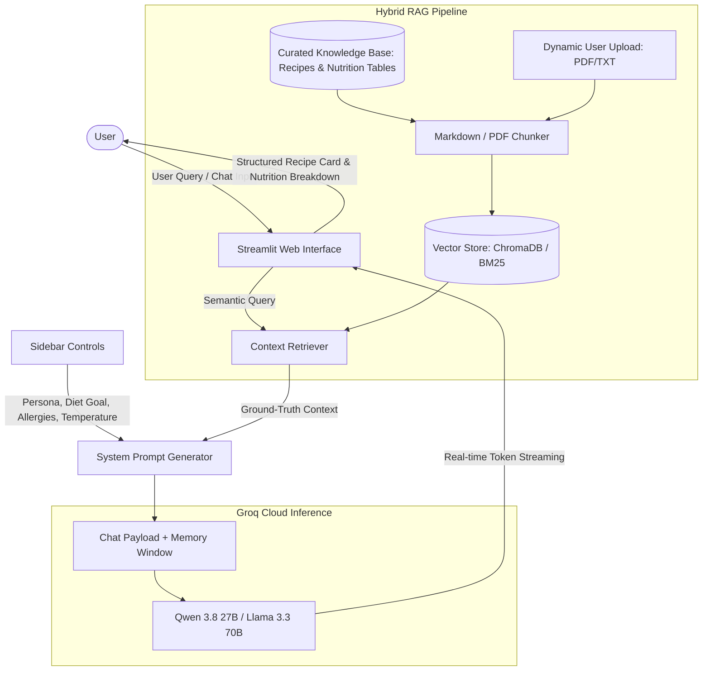

# 🥗 NutriChef AI — Smart Nutrition & Meal Planning Assistant

> **Final Project: AI-Powered Conversational Assistant with LLMs and Hybrid Retrieval-Augmented Generation (RAG)**  
> Built with **Python**, **Streamlit**, **Groq Cloud API (Qwen 3.8 27B & Llama 3.3 70B)**, and a **Dual-Engine Vector Store (ChromaDB + BM25)**.

[](https://www.python.org/)
[](https://streamlit.io/)
[](https://groq.com/)
[](https://groq.com/)
[](#-system-architecture)
[](LICENSE)

---

## 📖 1. Project Overview & Use Case

**NutriChef AI** is an intelligent nutrition consultant and interactive culinary meal planner designed to address a common daily dilemma: *"What can I cook today that is healthy, budget-friendly, and aligned with my personal fitness and health goals?"*

The system enables users to:
- Generate tailored healthy recipes based on available household ingredients.
- Calculate accurate daily caloric & macronutrient needs (BMR & TDEE formulas).
- Receive personalized meal plans adjusted for dietary goals, medical conditions (e.g., diabetes, hypertension), and food allergies.
- Access evidence-based nutritional knowledge via semantic document retrieval (RAG).

---

## 🎨 2. Creative Parameters & Key Features

NutriChef AI exposes an interactive sidebar with several configurable creative parameters:

### A. Persona & Tone of Voice
- 👨‍🍳 **Friendly & Inspiring Chef**: Warm, motivational, encouraging, and packed with practical culinary tips to make healthy food taste delicious.
- 🩺 **Clinical Dietitian**: Formal, evidence-based, data-driven, focusing on glycemic indexes, lipid profiles, and metabolic health.
- 🏋️‍♂️ **Fitness & Bodybuilding Coach**: Energetic, disciplined, results-oriented, focusing on daily protein targets, lean muscle growth, and workout recovery.

### B. Dietary Goal Customization
- **Caloric Deficit (Fat Loss)**: 300–500 kcal reduction below TDEE with high-protein and high-fiber volume.
- **Clean Bulking (Muscle Gain)**: Controlled calorie surplus with nutrient-dense complex carbs and lean protein sources.
- **Low Carbohydrate / Ketogenic**: Strict carb restriction (<50g/day) to encourage metabolic ketosis.
- **Low Sugar (Diabetes-Friendly)**: Low-GI ingredients (<55) designed to prevent blood glucose spikes.
- **Low Sodium (DASH Diet / Hypertension)**: Sodium restriction (<1,500 mg/day) using aromatic herbs and spices.

### C. Automated Allergy & Restriction Filter
Users can define food intolerances (e.g., *peanuts, shellfish, gluten, dairy*). The assistant dynamically filters out restricted ingredients and suggests safe culinary substitutions without compromising nutritional value.

### D. Advanced LLM Configuration (Groq Engine)
- **Model Switcher**: Powered by Groq's high-speed LPU inference with models including:
  - `qwen/qwen3.8-27b` (Default — cutting-edge reasoning and culinary logic).
  - `qwen-2.5-32b`
  - `llama-3.3-70b-versatile`
  - `llama-3.1-8b-instant` (Ultra-low latency streaming).
  - *Custom Model ID input option*.
- **Creativity Slider (Temperature)**: Adjustable from `0.0` (factual, strictly nutritional) to `1.0` (creative culinary brainstorming).

### E. Hybrid RAG (Retrieval-Augmented Generation)
- **Curated Knowledge Base**: Includes structured nutritional tables (Indonesian TKPI & USDA FoodData Central), evidence-based diet handbooks, and healthy recipes.
- **Dynamic File Ingestion**: Users can upload supplementary documents (PDF, TXT, Markdown) directly through the UI, which are immediately parsed and embedded into the vector store.
- **Dual Engine Resilience**: Primary semantic search using **ChromaDB** with `all-MiniLM-L6-v2` dense embeddings, backed by a deterministic **BM25 Lexical Fallback Engine**.

### F. Multi-turn Memory & Export
- **Context-Aware Dialogue**: Maintains sliding-window conversational memory to support follow-up adjustments (e.g., *"Replace the chicken breast with tofu and recalculate the calories"*).
- **Export Chat Transcript**: One-click download of the consultation history in clean Markdown format (`.md`).
- **Session Reset**: Instant context clearance button.

---

## 🏗️ 3. System Architecture



---

## 📁 4. Project Directory Structure

```text
nutrichef-ai/
├── app.py                      # Main Streamlit application & interactive UI
├── rag_pipeline.py             # RAG engine (ChromaDB vector store, BM25 fallback, PDF parser)
├── prompts.py                  # Persona definitions, clinical diet rules, and prompt templates
├── data/
│   └── knowledge_base/         # Curated factual nutrition datasets
│       ├── resep_sehat_nusantara.md    # Healthy recipe catalog with macro breakdowns
│       ├── tabel_nutrisi_bahan.md      # Calorie and macronutrient reference tables
│       └── panduan_diet_terstruktur.md # Clinical diet handbooks & allergy substitutions
├── docs/
│   └── screenshots/            # UI screenshots for final project deliverables
├── .env.example                # Environment variable configuration template
├── .gitignore                  # Git ignore rules (protects credentials and cache)
├── requirements.txt            # Python package dependencies
└── README.md                   # Comprehensive project documentation
```

---

## 🚀 5. Installation & Setup Guide

### Prerequisites
- Python **3.10** or newer installed.
- Free API Key from [Groq Cloud Console](https://console.groq.com/keys).

### Step-by-Step Instructions:

1. **Clone the Repository:**
   ```bash
   git clone https://github.com/<your-username>/nutrichef-ai.git
   cd nutrichef-ai
   ```

2. **Create and Activate a Virtual Environment:**
   ```bash
   # On Windows (PowerShell):
   python -m venv venv
   .\venv\Scripts\Activate.ps1

   # On macOS / Linux:
   python3 -m venv venv
   source venv/bin/activate
   ```

3. **Install Dependencies:**
   ```bash
   pip install -r requirements.txt
   ```

4. **Configure Environment Variables (Optional):**
   Copy `.env.example` to `.env` and insert your Groq API key:
   ```bash
   cp .env.example .env
   ```
   *Note: You can also enter the Groq API key directly into the sidebar field inside the web interface without touching the `.env` file.*

5. **Launch the Application:**
   ```bash
   streamlit run app.py
   ```
   The application will automatically open in your default browser at **`http://localhost:8501`**.

---

## 🧪 6. Evaluation & Testing Scenarios

Reviewers and graders can verify the system using these testing scenarios:

| # | Test Scenario | User Input | Expected Assistant Output |
|---|---|---|---|
| **1** | **Recipe Recommendation & Caloric Deficit** | *"I have chicken breast and oyster mushrooms in my fridge. Suggest a dinner recipe under 250 kcal."* | Retrieves the steamed chicken recipe from the RAG knowledge base, formats measured ingredients, instructions, and provides a clear macro breakdown. |
| **2** | **Persona Switching** | Change persona to *Clinical Dietitian* and ask: *"Why is brown rice preferred over white rice?"* | Explains glycemic index (GI), fiber content, and insulin sensitivity using evidence-based scientific terminology. |
| **3** | **Allergy Constraint Validation** | Enter `Shrimp, Peanuts` in the allergy input, then request a high-protein lunch suggestion. | Guaranteed exclusion of shellfish or peanut dressings, with safe alternative substitutions provided. |
| **4** | **Multi-Turn Context Revision** | Follow up with: *"Replace the carbohydrate source with boiled potatoes and recalculate the macros."* | Accurately remembers prior dish context and recalculates caloric and carbohydrate values based on boiled potatoes. |
| **5** | **Dynamic RAG File Ingestion** | Upload a custom PDF or TXT nutrition note in the sidebar and query its contents. | Parses new document chunks, updates the vector store, and cites the newly uploaded file in the response. |

---

## 📸 7. User Interface Screenshots

> *Screenshots demonstrating the sidebar configuration, conversational interface, recipe cards, and RAG citations:*

### Screenshot 1: Main Dashboard & Parameter Sidebar


### Screenshot 2: Recipe Card & Nutrition Breakdown


### Screenshot 3: Retrieved Knowledge Base Citations (RAG)


---

## 🛡️ 8. Security, Limitations & Future Work

- **Current Environment**: The application is tailored for single-user local deployment (`localhost`). Sensitive credentials are kept out of source control using `.gitignore` and `python-dotenv`.
- **Future Production Enhancements**:
  - Implement request rate-limiting to mitigate potential Denial of Service (DoS) attacks in public cloud deployments.
  - Implement strict server-side input sanitization for user-supplied dietary restrictions to prevent indirect prompt injection.
  - Integrate user authentication and persistent database storage (PostgreSQL / Supabase) for user profile histories.

---

## 👨‍💻 Author & Attribution
- **Project**: Final Project — AI & NLP Chatbot Development
- **Developer**: [Your Name / Richtjhie]
- **Institution / Course**: Final Project AI / LLM Track
